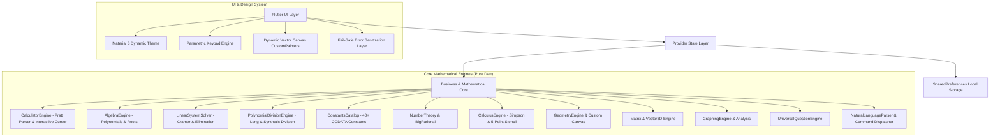

# Qalculyn — Technical Architecture & System Design

This document details the software architecture, design patterns, numerical stability considerations, and state management mechanisms underlying **Qalculyn**.

---

## 1. Architectural Philosophy & Principles

Qalculyn is architectured according to four strict tenets:

1. **Zero External Dependencies in Mathematical Kernels:** All mathematical evaluators, parsers, numerical algorithms, and matrix engines are written from scratch in pure Dart. No third-party computational libraries (`eval()`, JavaScript bridges, or native C++ math packages) are used.
2. **Total Separation of Concerns:** Core computational logic is decoupled from Flutter widgets. Mathematical engines accept primitive inputs or domain models and return deterministic, testable results.
3. **100% Offline by Design:** The application requests zero network permissions. Persistence is localized entirely within Android private app sandboxes.
4. **Consumer Ergonomics & Fail-Safe Sanitization:** Low-level parser exceptions and stack traces are trapped and converted into clean, human-readable guidance before reaching the UI.

---

## 2. System Architecture Diagram



---

## 3. Mathematical Subsystems

### 3.1 Pratt Expression Parser (`CalculatorEngine`)
Unlike traditional Dijkstra Shunting-Yard algorithms that require separate operator and output stacks, Qalculyn utilizes a **Top-Down Operator Precedence (Pratt) Parser**.

- **Tokenizer:** Converts the raw input string into typed tokens (`TokenType.number`, `TokenType.plus`, `TokenType.leftParen`, `TokenType.function_`, etc.).
- **Binding Powers:** Each infix operator is assigned left and right binding powers:
  $$\text{plus/minus}: (1, 2) \quad \text{multiply/divide}: (3, 4) \quad \text{power}: (6, 5)$$
  Because the left binding power of power ($6$) exceeds its right binding power ($5$), right-associativity ($2^{3^2} = 2^9 = 512$) is naturally satisfied.
- **Auto-Parenthesization:** The evaluator preprocesses expressions prior to parsing to balance unclosed parentheses, eliminating syntax errors when users tap `=` mid-expression.

### 3.2 Exact Arithmetic (`BigRational` & `NumberTheory`)
Floating-point approximations ($0.1 + 0.2 \neq 0.3$) introduce cumulative rounding errors in algebraic reductions.
- **`BigRational`:** Implemented as a pair of arbitrary-precision `BigInt` objects (`num`, `den`).
  - Automatically simplifies fractions to irreducible form using the Euclidean algorithm:
    $$\gcd(a, b) = \gcd(b, a \bmod b)$$
  - Normalizes denominators such that $\text{den} > 0$.
- **Number Theory:** Arbitrary-length prime factorizations using $6k \pm 1$ trial division and monotonic divisor generation.

### 3.3 Numerical Quadrature & Differentiation (`CalculusEngine`)
- **Numerical Differentiation:** Evaluates $f'(x_0)$ using the symmetrical **5-point central difference stencil**, providing an approximation error of order $O(h^4)$:
  $$f'(x_0) \approx \frac{-f(x_0 + 2h) + 8f(x_0 + h) - 8f(x_0 - h) + f(x_0 - 2h)}{12h}$$
  where $h = 10^{-5}$ represents the optimal step size balancing truncation error and floating-point cancellation.
- **Numerical Integration:** Evaluates $\int_a^b f(x)\,dx$ using **Composite Simpson's 1/3 Rule** across $N = 1000$ subintervals:
  $$\int_a^b f(x)\,dx \approx \frac{h}{3} \left[ f(x_0) + 4\sum_{i=1,3,\dots}^{N-1} f(x_i) + 2\sum_{i=2,4,\dots}^{N-2} f(x_i) + f(x_N) \right]$$
  yielding an asymptotic error bound of $O(h^4)$.

### 3.4 Linear Algebra & 3D Vector Geometry (`Matrix` & `Vector3D`)
- **Matrix Inversion:** Uses Gauss-Jordan elimination with partial pivoting for stability.
- **Determinants:** Computed via recursive Laplace cofactor expansion for small matrices ($n \le 3$) and upper-triangular $LU$ decomposition for larger matrices.
- **Reduced Row Echelon Form (RREF):** Performs Gauss-Jordan elimination tracking every elementary row operation (row swapping $R_i \leftrightarrow R_j$, row scaling $R_i \leftarrow \frac{1}{k} R_i$, and row elimination $R_k \leftarrow R_k - c R_i$) to produce step-by-step educational derivations.
- **Eigenvalues & Characteristic Polynomials:** Solves exact characteristic equations for $2\times2$ ($\lambda^2 - \text{tr}(A)\lambda + \det(A) = 0$) and $3\times3$ matrices ($\lambda^3 - \text{tr}(A)\lambda^2 + M\lambda - \det(A) = 0$) yielding exact real or complex eigenvalues.
- **3D Spatial Geometry:**
  $$\vec{u} \cdot \vec{v} = u_x v_x + u_y v_y + u_z v_z \qquad \vec{u} \times \vec{v} = \begin{pmatrix} u_y v_z - u_z v_y \\ u_z v_x - u_x v_z \\ u_x v_y - u_y v_x \end{pmatrix}$$
  $$\theta = \arccos\left(\frac{\vec{u} \cdot \vec{v}}{\|\vec{u}\| \|\vec{v}\|}\right)$$

### 3.5 Interactive Geometry & Vector Canvas (`GeometryCanvasWidget`)
- Uses Flutter's low-level `CustomPainter` API to render 2D plane figures and 3D isometric projections.
- Dynamically scales figures to fit available screen bounds while preserving dimensional aspect ratios.
- Renders dashed bounding boxes, dimension labels, and internal angle arcs.

### 3.6 Multi-Curve 2D Graphing Engine (`GraphingEngine`)
- Evaluates $N = 400$ equidistant samples over the visible viewport range $[x_{\min}, x_{\max}]$ for up to 3 simultaneous mathematical functions ($f_1, f_2, f_3$).
- **Root Finding:** Discovers sign-change intervals ($f(x_i) \cdot f(x_{i+1}) \le 0$) and converges on exact roots using the **Bisection Method** to a tolerance $\epsilon = 10^{-6}$.
- **Curve Intersections:** Evaluates the difference function $h(x) = f_a(x) - f_b(x)$ across viewport samples and refines intersection coordinates via bisection.
- **Extrema Detection:** Identifies discrete slope reversals ($f'(x_i) \cdot f'(x_{i+1}) \le 0$).

### 3.7 Bivariate Statistics Engine (`StatisticsEngine`)
- Accepts paired coordinate points $(x_i, y_i)$ and computes:
  - Slope $m = \frac{SS_{xy}}{SS_{xx}}$, Intercept $c = \bar{y} - m\bar{x}$
  - Pearson correlation coefficient $r = \frac{SS_{xy}}{\sqrt{SS_{xx} \cdot SS_{yy}}}$
  - Coefficient of determination $R^2 = r^2$
  - Step-by-step arithmetic proofs paired with an interactive scatter chart and best-fit trendline.

---

## 4. Zero-Syntax-Leakage & Error-Sanitization Layer

A key architectural enhancement in Qalculyn is the universal error trap implemented in [`lib/shared/tool_widgets.dart`](file:///c:/Users/shanj/OneDrive/Desktop/Calculator/lib/shared/tool_widgets.dart).

```dart
String cleanMathErrorMessage(Object? error, {String fallback = 'Please enter valid numbers'}) {
  if (error == null) return fallback;
  var msg = error.toString().trim();
  msg = msg.replaceAll('FormatException: ', '');
  msg = msg.replaceAll('Exception: ', '');

  if (msg.contains('Invalid radix-10') || msg.contains('Invalid double')) {
    return 'Please enter valid numbers';
  }
  if (msg.contains('Division by zero')) {
    return 'Cannot divide by zero';
  }
  if (msg.contains('TokenType') || msg.contains('Incomplete')) {
    return 'Incomplete calculation';
  }
  // Strip character offset indicators
  final atIndex = msg.indexOf(' (at character');
  if (atIndex != -1) msg = msg.substring(0, atIndex).trim();

  return msg.isNotEmpty ? msg : fallback;
}
```

### Double-Layer Safety Net
1. **Screen Level:** Calculation try-catch blocks route exceptions through `cleanMathErrorMessage`.
2. **Card Level:** The shared `ToolResultCard` automatically validates all map values. If any string contains raw `FormatException` or `Exception:` tokens, it is automatically sanitized before rendering.

---

## 5. State Management & Theme Persistence

Qalculyn adopts the **Provider** pattern (`ChangeNotifier`) for reactive, decoupled state propagation:

- **`SettingsProvider`:**
  - Manages `themeMode`, `accentColor`, `amoledBlack`, `keypadCornerRadius`, `angleMode`, and `decimalPlaces`.
  - Persists all settings instantaneously using asynchronous `SharedPreferences`.
  - Propagates custom theme palettes into `MaterialApp` using dynamic `ColorScheme.fromSeed`.
- **`CalculatorProvider`:**
  - Manages the main expression buffer, calculation history, and sign toggle state.
  - Automatically invokes real-time preview evaluation on input updates.

---

## 6. Security & Privacy Audit

- **Permissions:** The Android manifest declares zero dangerous permissions:
  ```xml
  <!-- No android.permission.INTERNET -->
  <!-- No android.permission.ACCESS_NETWORK_STATE -->
  <!-- No location, contacts, or storage permissions -->
  ```
- **Process Isolation:** Evaluates all calculations locally on the Android device's CPU. No input is ever transmitted over network sockets or shared across app boundaries.
